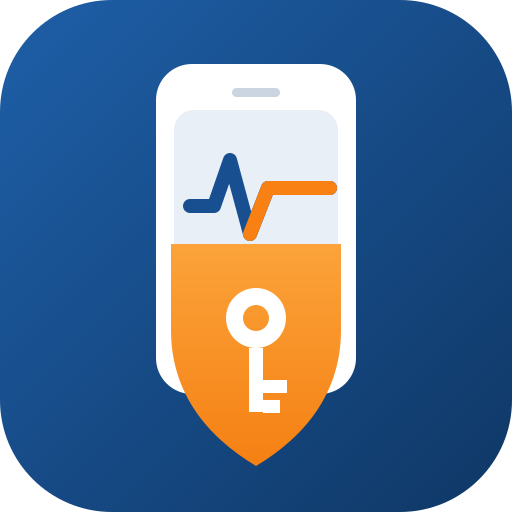

# Mobile Token Monitor — Guía del administrador



Plugin para Moodle 4.5 que permite saber **qué usuarios generan y usan tokens de la app
Moodle Mobile**, sin desactivar la app ni modificar el funcionamiento normal del sitio.

Está pensado para equipos de administración que necesitan supervisar el acceso móvil:
detectar tokens nuevos, revisar quién los usa, ver desde qué IP se conectan y recibir un
aviso cuando un usuario genera tokens de forma inusualmente repetida.

> **El plugin no guarda el token.** Nunca almacena la clave de acceso ni el token privado
> del usuario. Solo registra datos de control: quién, cuándo, desde qué IP y con qué
> servicio.

---

## 1. Qué hace el plugin

- Registra cuándo un usuario obtiene un token para la app Moodle Mobile.
- Registra el último acceso conocido del token.
- Muestra un panel con el historial y métricas de uso.
- Incorpora un **historial móvil por estudiante**: primer uso de la app, tokens generados,
  tokens activos, IPs utilizadas e historial de accesos.
- Permite detectar si un estudiante usa varios tokens, si se conecta desde IPs distintas y
  si alguno de sus tokens deja de utilizarse.
- Permite buscar por estudiante, usuario, tipo de evento, servicio y rango de fechas.
- Envía avisos a los administradores cuando se crea un token nuevo.
- Avisa cuando un usuario supera un número de tokens en un periodo (indicio de actividad
  que conviene revisar).
- Incorpora también los tokens creados desde la administración del sitio, aunque Moodle no
  emita ningún aviso en ese caso.
- Borra automáticamente los registros antiguos según la retención configurada.
- Respeta la privacidad: los datos personales se pueden exportar y eliminar desde las
  herramientas de privacidad de Moodle.

**Lo que el plugin no hace:**

- No bloquea, no caduca ni elimina tokens de Moodle.
- No desactiva Moodle Mobile.
- No interviene en el inicio de sesión de los usuarios.
- No guarda contraseñas, tokens ni información del dispositivo.

---

## 2. Requisitos

| Requisito | Detalle |
|---|---|
| Moodle | 4.5 o superior |
| PHP | 8.1 o superior (lo exige Moodle 4.5) |
| Servicios web | Activados en el sitio |
| Moodle Mobile | Servicio móvil activado (si no, no se generan tokens) |
| Base de datos | La que ya usa su Moodle (probado con MariaDB) |

Si la app móvil no está habilitada, el plugin se instala igualmente pero no tendrá nada que
registrar.

---

## 3. Instalación

1. Copie la carpeta del plugin en el servidor, dentro de Moodle, con este nombre exacto:

   ```
   <carpeta de Moodle>/local/mobilemonitor
   ```

2. Entre como administrador y abra **Administración del sitio → Notificaciones**. Moodle
   detectará el plugin y mostrará el botón para instalarlo.

3. Siga el asistente hasta el final y purgue las cachés desde
   **Administración del sitio → Desarrollo → Purgar todas las cachés**.

4. Revise los permisos (sección 8) y configure el plugin (sección 5).

> Si su equipo prefiere hacerlo por línea de comandos:
> `php admin/cli/upgrade.php --non-interactive` y después
> `php admin/cli/purge_caches.php`.

---

## 4. Actualización

1. Reemplace el contenido de la carpeta `local/mobilemonitor` por la nueva versión.
2. Abra **Administración del sitio → Notificaciones** y complete la actualización.
3. Purgue las cachés.

La configuración y el historial registrado se conservan entre versiones.

---

## 5. Configuración

Ruta: **Administración del sitio → Plugins → Plugins locales → Mobile Token Monitor**

| Opción | Para qué sirve | Valor inicial |
|---|---|---|
| Activar la monitorización | Encender o apagar todo el registro y los avisos. | Activado |
| Servicios monitorizados | Servicio o servicios móviles que se quieren vigilar. Normalmente no hay que tocarlo. | Servicio oficial de Moodle Mobile |
| Activar notificaciones | Enviar avisos a los administradores. | Activado |
| Destinatarios adicionales | IDs de usuarios que también deben recibir los avisos, separados por comas. | Vacío |
| Detección de actividad repetitiva | Analizar si un usuario genera demasiados tokens. | Activado |
| Umbral de tokens | Cuántos tokens en el periodo activan el aviso. | 5 |
| Periodo de evaluación | Ventana de tiempo del análisis, en horas. | 24 |
| Retención de registros | Días que se conserva el historial antes de borrarlo. | 90 |
| Periodo de inactividad | Días sin uso tras los cuales un estudiante o un token se consideran inactivos. | 30 |

### Servicios monitorizados

El plugin vigila el servicio **oficial de Moodle Mobile**. Si su sitio usa una app
personalizada (por ejemplo, basada en `local_mobile`), su equipo técnico puede añadir el
identificador de ese servicio en esta opción. Se recomienda no modificarla sin conocer el
identificador real del servicio.

### Quién recibe las notificaciones

1. Los administradores del sitio.
2. Los usuarios con permiso para ver el panel (sección 8).
3. Los usuarios indicados en *Destinatarios adicionales*.

Cada persona puede desactivar estos avisos desde sus preferencias de mensajería de Moodle
(**Preferencias → Notificaciones**). Para que lleguen por correo, el sitio debe tener el
envío de correo configurado y funcionando.

---

## 6. Uso del panel

Ruta: **Administración del sitio → Plugins → Plugins locales → Mobile Token Monitor**, o
directamente `/local/mobilemonitor/index.php`.

El panel muestra:

- Total de tokens móviles registrados.
- Cantidad de estudiantes involucrados.
- Tokens creados en las últimas 24 horas y en los últimos 7 días.
- Fecha de la última actividad registrada.
- Una tabla con: estudiante, nombre de usuario, servicio, fecha de creación, último acceso,
  IP y tipo de evento.

### Filtros disponibles

- **Nombre del estudiante** y **nombre de usuario**: búsqueda parcial.
- **Tipo de evento**: creado, utilizado o detectado.
- **Servicio web**.
- **Desde / hasta**: rango de fechas, con validación si el rango está invertido.

Los filtros se conservan al cambiar de página. El listado se muestra de 25 registros por
página.

### Historial por estudiante

Desde el panel, el botón **Ver estudiantes** abre `/local/mobilemonitor/students.php`, que
agrupa la actividad por estudiante y muestra:

- tokens generados y tokens activos;
- cantidad de IPs distintas;
- fecha del primer uso de la app y del último uso;
- estado **activo** o **inactivo** según el periodo de inactividad configurado.

Se puede buscar por nombre o usuario y filtrar por estado de uso. Al abrir **Ver detalle**
se muestra:

- el resumen del estudiante, incluida la fecha del **primer uso móvil detectado**;
- los tokens con fecha de creación, último uso, caducidad, IP de creación y estado;
- las IPs utilizadas, con su primer y último acceso;
- el historial de accesos agrupado por sesión e IP, con paginación.

El historial agrupa los accesos consecutivos del mismo token desde la misma IP en una sola
fila para no crecer sin control; el último acceso real siempre está disponible en el token.

> Un estudiante con varias IPs o varios tokens activos no implica un incidente: puede ser
> normal si cambia de red o usa varios dispositivos. El plugin lo señala para revisión.

---

## 7. Cómo interpretar los eventos y las alertas

| Evento | Significado |
|---|---|
| **Creado** | El usuario obtuvo un token nuevo al iniciar sesión en la app. Es lo habitual. |
| **Utilizado** | El token se volvió a solicitar (por ejemplo, al reabrir la app). No implica un problema. |
| **Detectado** | Un token que ya existía se incorporó al historial en la revisión automática, normalmente porque se creó desde la administración del sitio. |

**Aviso de generación repetitiva:** indica que un usuario superó el umbral de tokens en el
periodo configurado. El plugin lo presenta como **actividad que requiere revisión**, nunca
como un ataque confirmado. Antes de actuar, conviene comprobar:

- si el usuario cambió de dispositivo o reinstaló la app;
- si la IP coincide con su ubicación habitual;
- si existe algún script o integración que use sus credenciales;
- si el aviso se repite en el tiempo o fue un hecho puntual.

---

## 8. Permisos

El plugin agrega dos permisos:

| Permiso | Quién lo tiene por defecto | Qué permite |
|---|---|---|
| Ver el panel de tokens | Gestores | Consultar el panel y recibir los avisos. |
| Administrar la monitorización | Gestores | Reservado para tareas de administración. |

Puede ajustarlos en **Administración del sitio → Usuarios → Permisos → Definir roles**.
Los administradores del sitio siempre tienen acceso.

Recomendación: limite el acceso al panel a las personas que realmente necesitan revisar
estos datos.

---

## 9. Privacidad y protección de datos

El plugin está integrado con la herramienta de privacidad de Moodle:

- Declara qué datos personales trata.
- Permite exportar los datos de un usuario.
- Permite eliminarlos por usuario, por lista de usuarios o para todo el sitio.

**Datos que guarda:** usuario, identificador interno del token (no la clave), servicio,
tipo de evento, dirección IP, fecha de creación, último acceso e historial agrupado de
accesos móviles.

**Datos que no guarda:** valor del token, token privado, contraseñas, credenciales ni
información del dispositivo.

La retención se controla con la opción *Retención de registros*. Al cumplirse el plazo, los
registros antiguos se eliminan automáticamente. Esto afecta solo al historial del plugin,
nunca a los tokens de Moodle.

---

## 10. Mantenimiento automático

El plugin trabaja con dos tareas programadas que Moodle ejecuta por sí solo:

| Tarea | Cuándo se ejecuta | Qué hace |
|---|---|---|
| Revisión de tokens | Cada hora | Incorpora tokens creados sin aviso (por ejemplo, desde la administración). |
| Limpieza del historial | Una vez al día, de madrugada | Borra los registros más antiguos que la retención configurada. |

Puede verlas y comprobar su última ejecución en
**Administración del sitio → Servidores → Tareas programadas**. Si el cron del sitio no
está funcionando, estas tareas no se ejecutarán.

---

## 11. Preguntas frecuentes

**¿El plugin guarda el token del usuario?**
No. Solo guarda un identificador interno y datos de control. El token y el token privado
nunca se copian.

**¿Afecta al rendimiento del inicio de sesión móvil?**
No de forma apreciable: el registro es mínimo y el envío de avisos se hace fuera de la
petición del usuario.

**¿Por qué aparecen eventos "detectado"?**
Porque los tokens creados desde la administración del sitio o en lote no generan aviso en
Moodle. La revisión automática los incorpora con su fecha original.

**¿Puedo vigilar una app móvil personalizada?**
Sí, siempre que su equipo técnico añada el identificador del servicio en la configuración.

**¿Se eliminan tokens de Moodle al limpiar el historial?**
No. La limpieza solo borra registros propios del plugin.

**¿Puedo desactivar los avisos y seguir viendo el panel?**
Sí. Desactive *Activar notificaciones* y el panel seguirá registrando la actividad.

---

## 12. Solución de problemas

| Síntoma | Qué revisar |
|---|---|
| No aparece ningún registro | Que la monitorización esté activada, que los servicios web y el servicio móvil estén habilitados, y que el cron del sitio funcione. |
| Aparecen tokens de un servicio que no esperaba | Revise la opción *Servicios monitorizados*; el plugin distingue servicios por su identificador, no por su nombre visible. |
| No llegan los avisos | Compruebe la configuración de correo del sitio, que el destinatario no haya desactivado el aviso en sus preferencias y que tenga permiso para ver el panel o esté en *Destinatarios adicionales*. |
| El panel muestra "Usuario eliminado" | La cuenta fue borrada y el registro se conserva como histórico; puede eliminarlo desde las herramientas de privacidad. |
| La IP mostrada es la del proxy | Es la IP que recibe Moodle. Si el sitio está detrás de un proxy, su equipo técnico debe configurarlo correctamente. |
| Un aviso de repetición parece un falso positivo | Es posible: la detección es orientativa. Verifique dispositivo, IP y hábitos del usuario antes de concluir algo. |

---

## 13. Limitaciones conocidas

- El evento **utilizado** se conserva como último acceso del token; el historial de accesos
  del plugin se agrupa por sesión e IP para no crecer sin control.
- Los tokens creados antes de instalar el plugin se incorporan como **detectados**, con su
  fecha original y sin IP.
- Solo se vigilan los servicios configurados; un servicio nuevo debe añadirse a mano.
- La detección de repetición es orientativa y puede producir falsos positivos.
- No se ha validado en Moodle 5.x.

---

## 14. Notas para el equipo técnico

- Componente: `local_mobilemonitor`; versión 1.1.0; requiere Moodle 4.5.
- El servicio se identifica por su identificador interno (*shortname*), no por su nombre
  visible. Por defecto se vigila el servicio oficial `moodle_mobile_app`.
- Moodle no notifica la creación de tokens desde `admin/webservice/tokens.php` ni en la
  creación masiva; por eso existe la revisión horaria, que es la que marca esos registros
  como *detectados*.
- El panel requiere la capacidad `local/mobilemonitor:viewlogs` en el contexto de sistema.
- El envío de avisos usa la mensajería nativa de Moodle, con el proveedor
  `local_mobilemonitor/notification`.
- Las tareas se ejecutan por cron de Moodle:
  `local_mobilemonitor\task\sync_task` (cada hora) y
  `local_mobilemonitor\task\cleanup_task` (diaria).
- El historial por estudiante usa la tabla `local_mobilemonitor_access`, con una fila por
  sesión e IP (cambio de IP o más de 5 minutos entre accesos). El último acceso real sigue
  registrado por Moodle en `external_tokens.lastaccess`.
- Verificación realizada en desarrollo: instalación correcta, sintaxis PHP validada,
  comprobaciones funcionales del registro, filtros, notificaciones y privacidad. La batería
  PHPUnit/Behat queda pendiente de ejecución en el repositorio Git.

---

## 15. Licencia

GPL-3.0-or-later.
