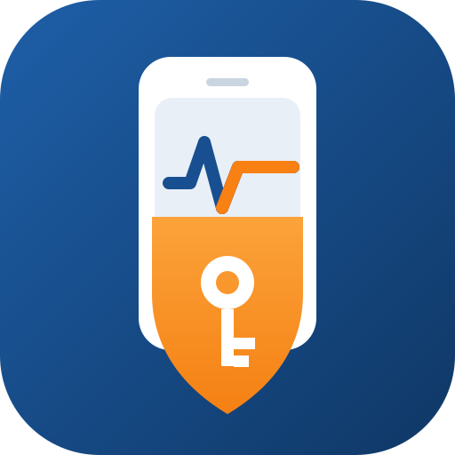

# Mobile Token Monitor — Administrator's Guide



A plugin for Moodle 4.5 that lets you find out **which users generate and use Moodle Mobile
app tokens**, without disabling the app or altering the normal operation of the site.

It is aimed at administration teams that need to supervise mobile access: detect new tokens,
review who uses them, see from which IP address they connect, and receive a warning when a
user generates tokens in an unusually repetitive way.

> **The plugin does not store the token.** It never stores the user's access key or private
> token. It only records control data: who, when, from which IP address and with which
> service.

---

## 1. What the plugin does

- Records when a user obtains a token for the Moodle Mobile app.
- Records the last known access of the token.
- Shows a panel with the history and usage metrics.
- Includes a **per-student mobile history**: first app use, generated tokens, active tokens,
  IP addresses used and access history.
- Helps detect whether a student uses several tokens, connects from different IP addresses,
  and whether any of their tokens stops being used.
- Allows searching by student, user, event type, service and date range.
- Sends warnings to administrators when a new token is created.
- Warns when a user exceeds a number of tokens within a period (an indication of activity
  worth reviewing).
- Also captures tokens created from site administration, even though Moodle does not emit
  any notification in that case.
- Automatically deletes old records according to the configured retention.
- Respects privacy: personal data can be exported and deleted from Moodle's privacy
  tools.

**What the plugin does not do:**

- It does not block, expire or delete Moodle tokens.
- It does not disable Moodle Mobile.
- It does not interfere with user log-in.
- It does not store passwords, tokens or device information.

---

## 2. Requirements

| Requirement | Details |
|---|---|
| Moodle | 4.5 or higher |
| PHP | 8.1 or higher (required by Moodle 4.5) |
| Web services | Enabled on the site |
| Moodle Mobile | Mobile service enabled (otherwise no tokens are generated) |
| Database | The one your Moodle already uses (tested with MariaDB) |

If the mobile app is not enabled, the plugin can still be installed, but it will have
nothing to record.

---

## 3. Installation

1. Copy the plugin folder into Moodle on the server, using this exact name:

   ```
   <Moodle folder>/local/mobilemonitor
   ```

2. Log in as an administrator and open **Site administration → Notifications**. Moodle will
   detect the plugin and show the button to install it.

3. Follow the wizard to the end and purge the caches from
   **Site administration → Development → Purge all caches**.

4. Review the permissions (section 8) and configure the plugin (section 5).

> If you prefer to do it from the command line:
> `php admin/cli/upgrade.php --non-interactive` and then
> `php admin/cli/purge_caches.php`.

---

## 4. Upgrade

1. Replace the contents of the `local/mobilemonitor` folder with the new version.
2. Open **Site administration → Notifications** and complete the upgrade.
3. Purge the caches.

Settings and recorded history are kept between versions.

---

## 5. Configuration

Path: **Site administration → Plugins → Local plugins → Mobile Token Monitor**

| Setting | Purpose | Default value |
|---|---|---|
| Enable monitoring | Turn all logging and warnings on or off. | Enabled |
| Monitored services | The mobile service(s) you want to watch. Normally you do not need to change this. | Official Moodle Mobile service |
| Enable notifications | Send warnings to administrators. | Enabled |
| Additional recipients | IDs of the users who should also receive the warnings, separated by commas. | Empty |
| Repetitive activity detection | Analyse whether a user generates too many tokens. | Enabled |
| Token threshold | How many tokens within the period trigger the warning. | 5 |
| Evaluation period | Time window of the analysis, in hours. | 24 |
| Record retention | Days the history is kept before being deleted. | 90 |
| Inactivity period | Days without use after which a student or token is considered inactive. | 30 |

### Monitored services

The plugin watches the **official Moodle Mobile service**. If your site uses a custom app
(for example, based on `local_mobile`), your technical team can add the identifier of that
service here. It is recommended not to change this without knowing the real service
identifier.

### Who receives the notifications

1. Site administrators.
2. Users with permission to view the panel (section 8).
3. The users listed in *Additional recipients*.

Each person can turn these warnings off from their Moodle messaging preferences
(**Preferences → Notifications**). For them to arrive by email, the site must have email
delivery configured and working.

---

## 6. Using the panel

Path: **Site administration → Plugins → Local plugins → Mobile Token Monitor**, or
directly `/local/mobilemonitor/index.php`.

The panel shows:

- Total registered mobile tokens.
- Number of students involved.
- Tokens created in the last 24 hours and in the last 7 days.
- Date of the last recorded activity.
- A table with: student, username, service, creation date, last access, IP address and
  event type.

### Available filters

- **Student name** and **username**: partial search.
- **Event type**: created, used or detected.
- **Web service**.
- **From / to**: date range, with validation when the range is reversed.

Filters are kept when changing page. The list is shown with 25 records per page.

### Per-student history

From the panel, the **View students** button opens `/local/mobilemonitor/students.php`,
which groups activity per student and shows:

- generated tokens and active tokens;
- number of different IP addresses;
- date of first app use and of last use;
- **active** or **inactive** status according to the configured inactivity period.

You can search by name or username and filter by usage status. Opening **View detail**
shows:

- the student summary, including the date of the **first detected mobile use**;
- the tokens with creation date, last use, expiry, creation IP and status;
- the IP addresses used, with their first and last access;
- the access history grouped by session and IP, with pagination.

The history groups consecutive accesses of the same token from the same IP address into a
single row so that it does not grow unbounded; the real last access is always available on
the token.

> A student with several IP addresses or several active tokens does not imply an incident:
> it can be normal if they change network or use several devices. The plugin flags it for
> review.

---

## 7. How to read the events and the alerts

| Event | Meaning |
|---|---|
| **Created** | The user obtained a new token when logging in to the app. This is the usual case. |
| **Used** | The token was requested again (for example, when reopening the app). It does not indicate a problem. |
| **Detected** | An existing token was added to the history by the automatic review, normally because it was created from site administration. |

**Repetitive generation warning:** it means that a user exceeded the token threshold within
the configured period. The plugin presents it as **activity that requires review**, never as
a confirmed attack. Before acting, it is worth checking:

- whether the user changed device or reinstalled the app;
- whether the IP address matches their usual location;
- whether there is a script or integration using their credentials;
- whether the warning repeats over time or was a one-off event.

---

## 8. Permissions

The plugin adds two capabilities:

| Capability | Who has it by default | What it allows |
|---|---|---|
| View the token panel | Managers | Consult the panel and receive the warnings. |
| Manage the monitoring | Managers | Reserved for administrative tasks. |

You can adjust them under **Site administration → Users → Permissions → Define roles**.
Site administrators always have access.

Recommendation: limit access to the panel to the people who really need to review this
data.

---

## 9. Privacy and data protection

The plugin is integrated with Moodle's privacy tool:

- It declares which personal data it processes.
- It allows exporting a user's data.
- It allows deleting them per user, per list of users, or for the whole site.

**Data it stores:** user, internal token identifier (not the key), service, event type, IP
address, creation date, last access and the grouped mobile access history.

**Data it does not store:** token value, private token, passwords, credentials or device
information.

Retention is controlled by the *Record retention* setting. Once the period elapses, the old
records are deleted automatically. This only affects the plugin's own history, never Moodle
tokens.

---

## 10. Automated maintenance

The plugin works with two scheduled tasks that Moodle runs on its own:

| Task | When it runs | What it does |
|---|---|---|
| Token review | Every hour | Picks up tokens created without notification (for example, from site administration). |
| History cleanup | Once a day, early in the morning | Deletes records older than the configured retention. |

You can inspect them and check their last run under
**Site administration → Server → Scheduled tasks**. If the site cron is not running, these
tasks will not execute.

---

## 11. Frequently asked questions

**Does the plugin store the user's token?**
No. It only stores an internal identifier and control data. The token and the private token
are never copied.

**Does it affect mobile log-in performance?**
Not noticeably: the logging is minimal and the warnings are sent outside the user request.

**Why do "detected" events appear?**
Because tokens created from site administration or in bulk do not trigger any notification
in Moodle. The automatic review adds them with their original date.

**Can I monitor a custom mobile app?**
Yes, as long as your technical team adds the service identifier in the configuration.

**Are Moodle tokens deleted when the history is cleaned up?**
No. The cleanup only deletes the plugin's own records.

**Can I turn the warnings off and still view the panel?**
Yes. Turn off *Enable notifications* and the panel will keep recording the activity.

---

## 12. Troubleshooting

| Symptom | What to check |
|---|---|
| No records appear | That monitoring is enabled, that web services and the mobile service are enabled, and that the site cron is running. |
| Tokens from an unexpected service appear | Check the *Monitored services* setting; the plugin identifies services by their identifier, not by their display name. |
| Warnings are not delivered | Check the site email configuration, whether the recipient turned the warning off in their preferences, and whether they have permission to view the panel or are listed under *Additional recipients*. |
| The panel shows "Deleted user" | The account was deleted and the record is kept as history; you can delete it from the privacy tools. |
| The IP shown is the proxy's | It is the IP address Moodle receives. If the site is behind a proxy, your technical team must configure it properly. |
| A repetition warning looks like a false positive | It can be: the detection is indicative. Check the device, IP address and habits of the user before concluding anything. |

---

## 13. Known limitations

- The **used** event is kept as the token's last access; the plugin's access history is
  grouped by session and IP so that it does not grow unbounded.
- Tokens created before the plugin was installed are added as **detected**, with their
  original date and no IP address.
- Only the configured services are watched; a new service must be added manually.
- The repetition detection is indicative and may produce false positives.
- It has not been validated on Moodle 5.x.

---

## 14. Notes for the technical team

- Component: `local_mobilemonitor`; version 1.1.2; requires Moodle 4.5.
- The service is identified by its internal identifier (*shortname*), not by its display
  name. By default the official `moodle_mobile_app` service is watched.
- Moodle does not notify token creation from `admin/webservice/tokens.php` nor in bulk
  creation; that is why the hourly review exists, and it is what marks those records as
  *detected*.
- The panel requires the `local/mobilemonitor:viewlogs` capability in the system context.
- Warnings are sent using Moodle's native messaging, with the provider
  `local_mobilemonitor/notification`.
- Tasks run through Moodle cron:
  `local_mobilemonitor\task\sync_task` (hourly) and
  `local_mobilemonitor\task\cleanup_task` (daily).
- The per-student history uses the `local_mobilemonitor_access` table, with one row per
  session and IP (IP change or more than 5 minutes between accesses). The real last access
  is still recorded by Moodle in `external_tokens.lastaccess`.
- Verification carried out in development: correct installation, PHP syntax validated,
  functional checks of the logging, filters, notifications and privacy. The PHPUnit/Behat
  suite is still pending execution in the Git repository.

---

## 15. License

GPL-3.0-or-later.
